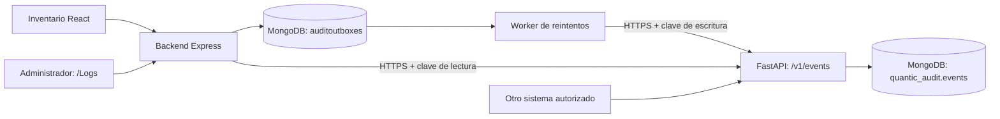

# Servicio de Control de Accesos y Auditoría

Microservicio Python/FastAPI con persistencia MongoDB, independiente de Quantic. Implementa el servicio 3.1 del APF1: registrar usuario, fecha/hora, ruta y operación; permitir consultas a supervisores autorizados. Las fechas se representan con un único timestamp ISO 8601 con zona horaria, normalizado a UTC. El servicio no sustituye el login del consumidor: el inventario autentica a la persona y comunica su identificador confirmado.

## Arquitectura



- La base del servicio es independiente de la del inventario. No comparte modelos de usuarios, sesiones ni secretos JWT.
- El backend registra GET, POST, PUT, PATCH, DELETE y también HEAD/OPTIONS. Incluye accesos rechazados y respuestas HTTP de error. Los cierres de conexión anticipados se representan con 499.
- Cada clave se vincula a un `source` y permisos `events:write` o `events:read`. El origen se obtiene de la credencial, nunca del cuerpo enviado. Un sistema no puede leer o escribir registros de otro.
- El frontend nunca recibe claves del servicio. `/api/audit/events` y `/api/audit/delivery` requieren sesión y rol admin en Express.
- La API de auditoría no ofrece modificación ni eliminación de registros. Esto no impide a un administrador de MongoDB alterarlos: para garantías contra manipulación se requieren controles adicionales de infraestructura.

## Inicio local en Windows

Requisitos: Python 3.12+, Node compatible con el proyecto y MongoDB accesible. Desde `audit-service`:

```powershell
python -m venv .venv
.venv/Scripts/python.exe -m pip install -r requirements-dev.txt
.venv/Scripts/python.exe scripts/configure_dev.py
.venv/Scripts/python.exe -m uvicorn app.main:create_app --factory --host 127.0.0.1 --port 8001 --no-access-log
```

El configurador se ejecuta una sola vez. Crea claves independientes de 48 bytes aleatorios, agrega los secretos a `server/.env`, guarda solo hashes SHA-256 en `clients.local.json` y genera `.env` del servicio. No imprime las claves ni sobrescribe una configuración existente. Es una configuración de desarrollo para MongoDB local; adaptar los URI en producción. Los archivos locales se excluyen de Git.

En otra terminal, desde `server`: `npm start`. Desde `vite-project`: `npm run dev`. Iniciar sesión con una cuenta admin y abrir **Auditoría** (`/Logs`). No se modifica automáticamente el rol de ninguna cuenta. Para el primer administrador existe `npm run create-admin` en `server`.

- Servicio: `http://127.0.0.1:8001`
- Documentación interactiva: `http://127.0.0.1:8001/docs`
- Contrato OpenAPI: `http://127.0.0.1:8001/openapi.json` y copia en `openapi.json`.
- Salud del proceso: `GET /health/live`; disponibilidad de MongoDB: `GET /health/ready`.

## Contrato para cualquier consumidor

Autenticación por `Authorization: Bearer <clave-del-consumidor>`. Sin cookies ni dependencia del frontend de Quantic. Usar HTTPS en despliegues remotos; HTTP se limita al desarrollo local.

### Registrar un evento

`POST /v1/events`, `Content-Type: application/json`, clave con `events:write`:

```json
{
  "event_id": "3ee510c9-515b-4bc4-bb29-95b7b1010fe0",
  "occurred_at": "2026-09-27T20:30:00.000Z",
  "actor_id": "usuario-123",
  "method": "PATCH",
  "path": "/api/devices/editDevice/507f1f77bcf86cd799439011",
  "status_code": 200,
  "duration_ms": 24,
  "request_id": "1715802e-7e6d-4c57-94fb-d9d7a530dd12"
}
```

- `actor_id`: identificador del usuario autenticado; `null` cuando no se pudo confirmar la identidad. No enviar contraseñas ni correos innecesarios.
- `occurred_at`: hora del evento en el consumidor; `received_at` lo asigna el proveedor. Fechas sin zona y más de cinco minutos en el futuro se rechazan. La precisión almacenada es de milisegundos.
- `path`: ruta sin parámetros de consulta, fragmentos ni datos secretos. Evitar credenciales en segmentos de ruta.
- `event_id`: UUID nuevo por operación; reutilizarlo al reintentar **el mismo evento**. `request_id`: UUID de correlación.
- Máximo 16 KiB por solicitud. Se rechazan campos desconocidos, cuerpos arbitrarios, métodos y tipos inválidos.
- `201`: creado. `200`: ya se recibió el mismo evento. `409`: mismo event_id del mismo origen con contenido distinto. No se sobrescribe.
- `401`: clave inválida. `403`: clave sin permiso. `413`: cuerpo demasiado grande. `422`: datos/filtros inválidos. `503`: MongoDB no disponible.

### Consultar

`GET /v1/events`, clave con `events:read`. Parámetros opcionales:

| Parámetro | Significado |
| --- | --- |
| actor_id | Coincidencia exacta del identificador de usuario |
| method | GET, POST, PUT, PATCH, DELETE, HEAD u OPTIONS |
| path | Coincidencia exacta de ruta |
| status_code | Estado HTTP, entre 100 y 599 |
| since / until | Intervalo inclusivo por fecha del evento, ISO 8601 con zona |
| limit | 1 a 100; por defecto 50 |
| cursor | next_cursor de la respuesta anterior |

```json
{"items": [], "next_cursor": null}
```

El orden es por identificador de recepción descendente; un evento antiguo reenviado aparece como recibido recientemente, conservando su fecha de ocurrencia. La paginación usa cursor, no offsets. Los filtros nunca se interpretan como operadores MongoDB ni expresiones regulares. No se admite `source` como filtro: siempre lo determina la credencial.

Para añadir un consumidor: generar una clave aleatoria de al menos 32 bytes, guardar únicamente su SHA-256 en una entrada de `clients.local.json` con `id`, `source` y `scopes`; entregar la clave por un canal seguro al backend del consumidor y reiniciar el servicio. Separar claves de escritura y lectura. Para rotar, mantener temporalmente entradas con hashes distintos, migrar el consumidor y retirar la entrada anterior. Los supervisores externos pueden tener claves de solo lectura para el origen autorizado, o usar su propio backend con autorización por usuario. No exponer una clave de servicio en JavaScript del navegador.

Ejemplo de consumidor en `examples/consumer.py`, usando variables `AUDIT_URL` y `AUDIT_API_KEY`.

## Entrega y fallos

1. Al finalizar la respuesta del inventario, el middleware guarda el evento en `auditoutboxes` de su base MongoDB.
2. Un worker reclama documentos mediante una concesión de 60 segundos. Cada dos segundos procesa hasta 25 eventos, con timeout HTTP de 3 segundos y backoff exponencial hasta aproximadamente cinco minutos.
3. Solo elimina el pendiente al recibir un acuse que coincida con el event_id. Si el servicio recibió el evento pero se perdió el acuse, el índice único `(source,event_id)` evita duplicarlo.
4. Errores de red, 408, 429 y 5xx conservan el evento pendiente. Otros 4xx pasan a `state=failed` sin eliminarlo. La pantalla muestra esos fallos. Tras corregir clave o formato, un operador puede revisar el evento y restablecer manualmente state=pending, nextAttemptAt y lockedUntil; no reutilizar un ID con otro contenido.
5. Los pendientes sobreviven al reinicio del backend. Concesiones vencidas se recuperan. No hay TTL sobre la cola: supervisar el espacio, el retraso y los pendientes/fallidos.

**Límite explícito:** la captura se realiza tras la respuesta y la persistencia en la cola no forma una transacción con el cambio de inventario. Un corte abrupto entre la respuesta y la escritura, o la caída de la base del inventario, puede perder ese evento. Se emite `audit_enqueue_failed` sin datos sensibles. La política prioriza disponibilidad del inventario; no se promete entrega exactamente una vez ni auditoría transaccional. Si se requiere no aceptar cambios sin auditoría durable, hay que migrar a transacciones de MongoDB (replica set) y acordar una política de rechazo ante fallos.

## Retención, seguridad y despliegue

- `AUDIT_RETENTION_DAYS=0` conserva registros. Un valor positivo asigna expires_at a nuevos eventos y habilita su eliminación por TTL. No modificar la retención sin aprobación del responsable; los registros ya creados conservan su política original y el borrado TTL no es instantáneo.
- No se importó automáticamente el antiguo `cambios.log`: puede contener contraseñas. Una migración histórica exige limpieza y una política de retención.
- Configurar HTTPS en el proxy, red privada, límites de solicitudes por cliente/IP y tamaño/tiempo del cuerpo; no publicar MongoDB ni las claves. El servicio no habilita CORS porque sus consumidores son servidores.
- Desactivar el access log estándar de Uvicorn como en el comando provisto para no registrar query strings. Los logs operativos estructurados del servicio excluyen cuerpos y credenciales. Configurar captura y retención de stdout/stderr en el despliegue.
- Usar cuentas MongoDB distintas: servicio con insert/find sobre events; backend con permisos sobre su outbox. Provisionar índices con una cuenta de despliegue. El arranque actual crea índices y necesita ese permiso; ajustar el procedimiento para cuentas de mínimo privilegio.
- Restringir acceso a clients.local.json y .env mediante permisos del sistema o un gestor de secretos. El Dockerfile no copia secretos y ejecuta como usuario sin privilegios; montar configuración de solo lectura y configurar AUDIT_CLIENTS_FILE con ruta absoluta.
- El servicio admite múltiples clientes pero confía en que cada backend envíe identidades verdaderas. Una clave de escritura comprometida permite crear eventos falsos para su propio origen; mitigar con rotación, red privada, monitoreo y autenticación de servicio más fuerte cuando el riesgo lo exija.
- No hay certificación ASVS ni evidencia inmutable externa. Pendientes de producción: gestión de claves, revisión de retención, alertas, backups, protección contra alteración por administradores de base y pruebas de carga.

## Pruebas

Desde `audit-service`: `.venv/Scripts/python.exe -m pytest -q`. Usa MongoDB local con bases aleatorias `audit_pytest_*`; comprueba autenticación, permisos, aislamiento de consumidores, idempotencia, conflictos, filtros, cursores, fechas, tamaño y fallos de DB. Elimina solo sus bases de prueba.

Desde `server`:

```powershell
npm test
npm run test:integration
npm run test:audit
```

La última prueba levanta una instancia Python en puerto temporal con claves y bases exclusivas; verifica Express → cola MongoDB → FastAPI → MongoDB → consulta admin, reintentos e idempotencia. Usa `.venv` del servicio; se puede indicar otro ejecutable mediante AUDIT_PYTHON. No usa ni modifica registros de producción. Desde `vite-project`: `npm run lint` y `npm run build`.

## Referencias de implementación

- [FastAPI: ciclo de vida de la aplicación](https://fastapi.tiangolo.com/advanced/events/).
- [PyMongo: índices e índices únicos](https://www.mongodb.com/docs/languages/python/pymongo-driver/current/indexes/).
- Documento de alcance: AvanceProyectoFinal1 - Grupo 5 (APF1), sección 3.1 y principios SOA.
